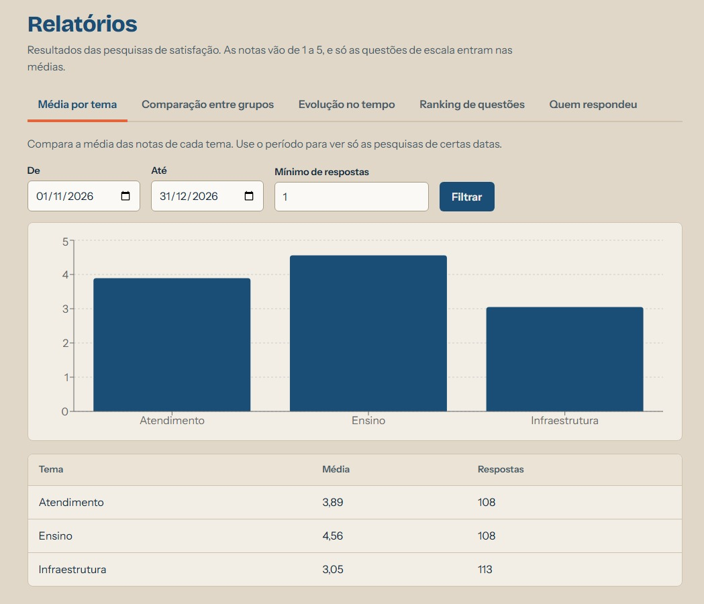
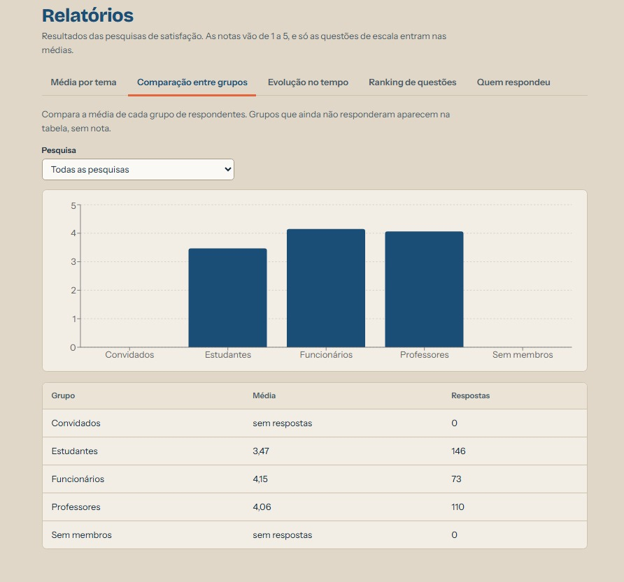
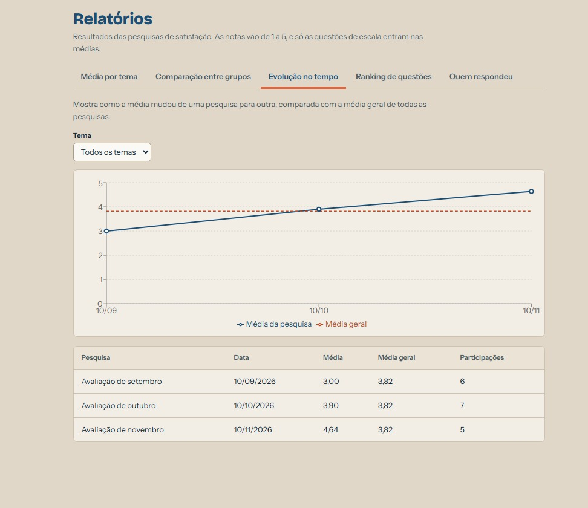
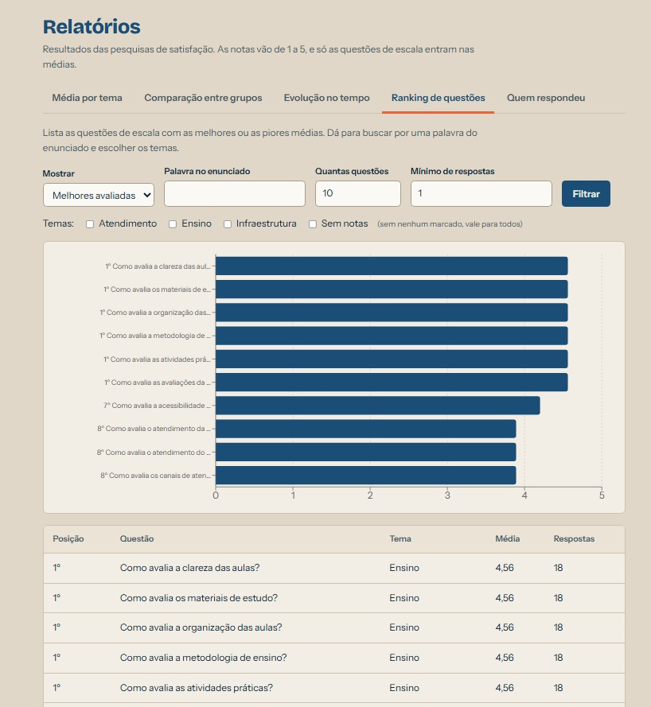
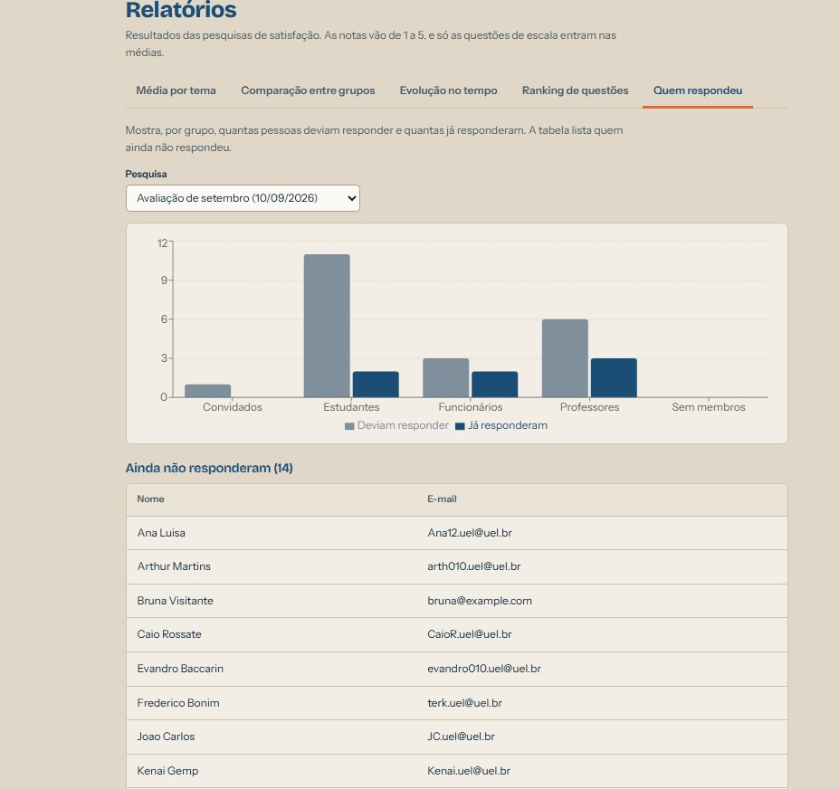

Trabalho da disciplina de Banco de Dados, fazendo sobre o tema 4 (Pesquisa)

Participantes:

Eduardo Rodrigues Abreu

Caio Eduardo Rossate 

Natureza: Pesquisa de satisfação ou de opinião

Executar o schema e depois o carga sql,preencher o .env, rodar o backend e depois usar npm run dev no frontend

Fazer Login com conta exemplo
email: eduardo.uel@uel.br
senha: Teste123!

## Relatórios

As consultas estão em [database/relatorios.sql](database/relatorios.sql). Abaixo estão as versões
básicas, sem os filtros opcionais acrescentados pelo DAO. Os símbolos `?` são parâmetros
preenchidos pelo `PreparedStatement`; para executar no pgAdmin, substitua-os por valores.

### 1. Média por tema

Objetivo: comparar a satisfação dos participantes em cada tema, como Infraestrutura, Atendimento e Ensino.

O relatório calcula a média das notas de escala e apresenta a quantidade de respostas de cada tema. As respostas de texto não entram no cálculo. É possível filtrar pelo período das pesquisas e definir uma quantidade mínima de respostas.

O gráfico de barras permite comparar as médias, enquanto a tabela apresenta os valores e as contagens. Quanto maior a média, melhor foi a avaliação daquele tema.

Recursos SQL utilizados: JOIN, WHERE, filtros por data, AVG, COUNT, GROUP BY, HAVING, ORDER BY, ROUND e COALESCE.



**SQL utilizado**

```sql
Select
    t.id_tema,
    t.nome_tema,
    coalesce(round(avg(r.valor_escala), 2), 0) as media,
    count(r.id_resposta) as total_respostas
from tema t
join questao q on q.id_tema = t.id_tema
join tipo_questao tq on tq.id_tipo_questao = q.id_tipo_questao
join resposta r on r.id_questao = q.id_questao
join participacao par on par.id_part = r.id_part
join pesquisa p on p.id_pesquisa = par.id_pesquisa
where tq.nome_tipo = 'ESCALA' and r.valor_escala is not null
group by t.id_tema, t.nome_tema
having count(r.id_resposta) >= ?
order by t.nome_tema, t.id_tema;
```

Na consulta básica, o parâmetro é o mínimo de respostas. Se o período for preenchido, o DAO
acrescenta `and p.data_pesquisa >= ?` e/ou `and p.data_pesquisa <= ?` antes do `group by`.

### 2. Comparação entre grupos

Objetivo: comparar as avaliações feitas pelos grupos de respondentes, como Estudantes, Professores e Funcionários.

O relatório apresenta a média das notas e a quantidade de respostas de escala de cada grupo. A resposta é atribuída ao grupo registrado na participação. É possível consultar todas as pesquisas ou selecionar uma pesquisa específica.

O gráfico de barras compara as médias dos grupos. A tabela também mostra os grupos sem notas, identificados como “sem respostas”.

Recursos SQL utilizados: LEFT JOIN, JOIN, subconsulta com IN, AVG, COUNT, GROUP BY, ORDER BY, ROUND e COALESCE. Quando uma pesquisa é selecionada, são acrescentados os filtros correspondentes.



**SQL utilizado**

```sql
Select
    g.id_grupo,
    g.nome_grupo,
    coalesce(round(avg(r.valor_escala), 2), 0) as media,
    count(r.valor_escala) as total_respostas
from grupo g
left join participacao par on par.id_grupo_respondente = g.id_grupo
left join resposta r on r.id_part = par.id_part
   and r.id_questao in (
       select q.id_questao
       from questao q
       join tipo_questao tq on tq.id_tipo_questao = q.id_tipo_questao
       where tq.nome_tipo = 'ESCALA'
   )
group by g.id_grupo, g.nome_grupo
order by g.nome_grupo, g.id_grupo;
```

Esta versão considera todas as pesquisas. Quando uma pesquisa é selecionada, o DAO acrescenta
`and par.id_pesquisa = ?` ao `left join participacao` e restringe os grupos com
`where g.id_grupo in (select gp.id_grupo from grupo_pesquisa gp where gp.id_pesquisa = ?)`.

### 3. Evolução no tempo

Objetivo: acompanhar como a satisfação mudou de uma pesquisa para outra.

O relatório calcula a média das notas de cada pesquisa e apresenta os resultados em ordem de data. Também mostra a média geral das notas consideradas, permitindo comparar cada pesquisa com essa referência. É possível selecionar um tema ou considerar todos.

O gráfico de linhas mostra a evolução das médias. A tabela apresenta o título, a data, a média da pesquisa, a média geral e a quantidade de participações com notas no filtro. Pesquisas sem notas não aparecem no resultado.

A média geral é calculada sobre todas as notas selecionadas, considerando suas quantidades, e não pela média das médias das pesquisas.

Recursos SQL utilizados: WITH, JOIN, WHERE, subconsulta, AVG, COUNT(DISTINCT), GROUP BY, ORDER BY, ROUND e COALESCE.



**SQL utilizado**

```sql
with notas as (
    select p.id_pesquisa, p.titulo, p.data_pesquisa, par.id_part, r.valor_escala
    from pesquisa p
    join participacao par on par.id_pesquisa = p.id_pesquisa
    join resposta r on r.id_part = par.id_part
    join questao q on q.id_questao = r.id_questao
    join tipo_questao tq on tq.id_tipo_questao = q.id_tipo_questao
    where tq.nome_tipo = 'ESCALA' and r.valor_escala is not null
)
select
    id_pesquisa,
    titulo,
    data_pesquisa,
    coalesce(round(avg(valor_escala), 2), 0) as media,
    count(distinct id_part) as participacoes,
    coalesce(round((select avg(valor_escala) from notas), 2), 0) as media_geral
from notas
group by id_pesquisa, titulo, data_pesquisa
order by data_pesquisa, id_pesquisa;
```

Esta versão considera todos os temas. Ao selecionar um tema, o DAO acrescenta
`and q.id_tema = ?` dentro da consulta `notas`, antes do fechamento do `with`.

### 4. Ranking de questões

Objetivo: identificar as questões de escala com as melhores ou as piores avaliações.

O relatório calcula a média e a quantidade de respostas de cada questão, organizando os resultados em um ranking. É possível escolher a ordem, buscar uma palavra no enunciado, selecionar temas, estabelecer um mínimo de respostas e limitar a quantidade de questões exibidas.

O gráfico de barras facilita a comparação das notas. A tabela apresenta a posição, o enunciado, o tema, a média e a quantidade de respostas. Questões com a mesma média recebem a mesma posição no ranking.

Recursos SQL utilizados: JOIN, WHERE, LIKE, LOWER, IN, AVG, COUNT, GROUP BY, HAVING, RANK() OVER, ORDER BY, LIMIT, ROUND e COALESCE.



**SQL utilizado**

```sql
Select
    rank() over (order by avg(r.valor_escala) desc) as posicao,
    q.id_questao,
    q.descricao,
    t.id_tema,
    t.nome_tema,
    coalesce(round(avg(r.valor_escala), 2), 0) as media,
    count(r.id_resposta) as total_respostas
from questao q
join tema t on t.id_tema = q.id_tema
join tipo_questao tq on tq.id_tipo_questao = q.id_tipo_questao
join resposta r on r.id_questao = q.id_questao
where tq.nome_tipo = 'ESCALA' and r.valor_escala is not null
  and lower(q.descricao) like lower(?) escape '!'
group by q.id_questao, q.descricao, t.id_tema, t.nome_tema
having count(r.id_resposta) >= ?
order by posicao, q.id_questao
limit ?;
```

Os parâmetros são, nesta ordem: busca, mínimo de respostas e limite. Uma busca por
`atendimento`, por exemplo, utiliza `%atendimento%`; sem busca, utiliza `%%`.
Para mostrar as piores avaliações, o DAO usa `asc` no lugar de `desc` no `rank`.
Quando há temas selecionados, acrescenta `and q.id_tema in (?, ...)` antes do `group by`.

### 5. Quem respondeu

Objetivo: acompanhar a participação dos usuários em uma pesquisa e identificar quem ainda não respondeu.

Após selecionar uma pesquisa, o relatório apresenta, por grupo, quantos usuários deveriam responder, quantos concluíram e quantos estão pendentes. O gráfico compara os participantes esperados com os que já responderam. A tabela lista o nome e o e-mail dos pendentes.

A consulta utiliza o controle de participação, sem associar os usuários ao conteúdo das respostas anônimas. Um usuário pertencente a vários grupos pode ser contado em cada grupo, mas aparece apenas uma vez na lista de pendentes. As contagens consideram a composição atual dos grupos.

Recursos SQL utilizados: JOIN, LEFT JOIN, WHERE, COUNT, CASE, DISTINCT, GROUP BY, ORDER BY e IS NULL.



**SQL utilizado**

Contagem por grupo:

```sql
SELECT g.id_grupo, g.nome_grupo, count(gu.id_usu) as esperados,
       count(case when cp.concluida = true then gu.id_usu end) as respondidos,
       count(gu.id_usu) - count(case when cp.concluida = true then gu.id_usu end) as pendentes
FROM grupo_pesquisa gp
JOIN grupo g ON g.id_grupo = gp.id_grupo
LEFT JOIN grupo_usuario gu ON gu.id_grupo = g.id_grupo
LEFT JOIN controle_participacao cp ON cp.id_usu = gu.id_usu AND cp.id_pesquisa = gp.id_pesquisa
WHERE gp.id_pesquisa = ?
GROUP BY g.id_grupo, g.nome_grupo
ORDER BY g.nome_grupo, g.id_grupo;
```

Lista de pendentes:

```sql
SELECT DISTINCT u.id_usu, u.nome, u.email
FROM grupo_pesquisa gp
JOIN grupo_usuario gu ON gu.id_grupo = gp.id_grupo
JOIN usuario u ON u.id_usu = gu.id_usu
LEFT JOIN controle_participacao cp ON cp.id_usu = u.id_usu AND cp.id_pesquisa = gp.id_pesquisa
WHERE gp.id_pesquisa = ? AND (cp.concluida = false OR cp.id_usu IS NULL)
ORDER BY u.nome, u.id_usu;
```

As duas consultas recebem o ID da pesquisa selecionada. A primeira produz as contagens
usadas pelo gráfico; a segunda produz a tabela de pendentes, sem repetir usuários.
